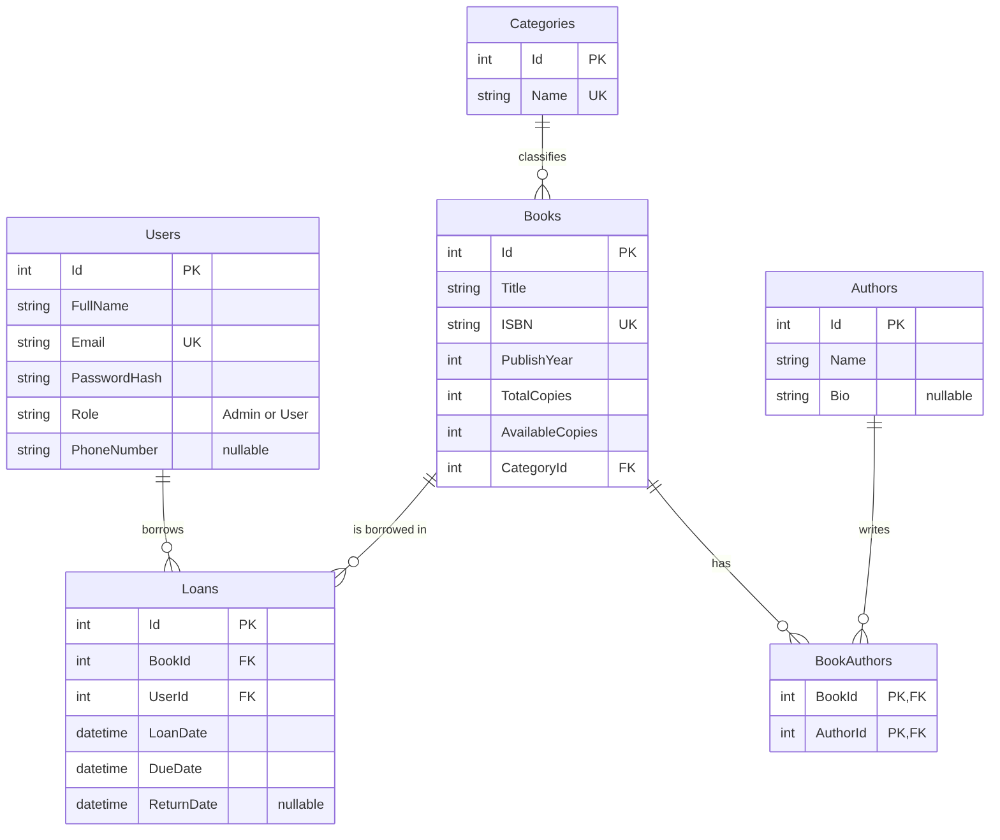

# Library Management System

A small full-stack library system: ASP.NET Core Web API (Clean Architecture) with a vanilla HTML/CSS/JS frontend.

## Idea

Users browse and search books, borrow them and return them. Admins manage books, authors and categories and can see overdue loans.

**Business rules**
- A book cannot be borrowed when `AvailableCopies` is 0.
- A user can have at most 3 active loans.
- A user cannot borrow the same book twice before returning it.
- The loan period is 14 days. A loan is overdue when `DueDate` has passed and it is not returned.
- Business failures return `400` with a clear message.

## Project structure

```
Library/                 API (controllers, Program.cs, middleware, Swagger, JWT setup)
LibraryApplication/      DTOs, interfaces, services (business rules), exceptions
LibraryDomain/           Entities and enums only
LibraryInfrastructure/   DbContext, repositories, migrations, JWT generation, password hashing
frontend/                Vanilla HTML/CSS/JS client
docs/                    ERD (erd.png)
```



## Requirements

- .NET SDK 10.0
- SQL Server (local instance, default connection string uses `Server=.`)
- Visual Studio 2022+ or the `dotnet` CLI
- Any static file server for the frontend (VS Code Live Server, or Python)

## How to run

1. **Clone**
   ```
   git clone https://github.com/AhmadAboQorah/Library.git
   cd Library
   ```
2. **Connection string**: open `Library/appsettings.json` and change `ConnectionStrings:DefaultConnection` if your SQL Server is not `Server=.` with Windows authentication.
3. **Run the API** (profile `http`, port 5149):
   ```
   dotnet run --project Library --launch-profile http
   ```
   On startup the app applies the migrations (`MigrateAsync`) and seeds the data, so no manual database step is needed.
4. Open Swagger: <http://localhost:5149/swagger>
5. **Run the frontend**: from the `frontend` folder:
   ```
   python -m http.server 5500
   ```
   then open <http://localhost:5500>. (Or use VS Code Live Server on `frontend/index.html`.)
   The API address is set in `frontend/js/config.js` (`API_BASE = "http://localhost:5149"`).

## Demo accounts

| Role  | Email               | Password  |
|-------|---------------------|-----------|
| Admin | admin@library.com   | Admin@123 |
| User  | user@library.com    | User@123  |

These are development-only demo accounts created by the seed. The JWT key in `appsettings.json` is also a development placeholder and must be replaced for any real deployment.

## Main endpoints

| Area | Endpoint | Access |
|------|----------|--------|
| Auth | `POST /api/auth/register`, `POST /api/auth/login` | Public |
| Books | `GET /api/books?title=&categoryId=`, `GET /api/books/{id}` | Public |
| Books | `POST`, `PUT /api/books/{id}`, `DELETE /api/books/{id}` | Admin |
| Authors, Categories | CRUD | Admin |
| Loans | `POST /api/loans`, `PUT /api/loans/{id}/return`, `GET /api/loans/my` | User |
| Loans | `GET /api/loans/overdue` | Admin |

Status codes used: 200, 201, 204, 400, 401, 403, 404.

## Technical notes

- EF Core Code First with Fluent API; two migrations: `InitialCreate` and `MakePhoneNumberOptional` (second migration changes `Users.PhoneNumber` to nullable, max 30).
- Repository pattern; `IUnitOfWork` is implemented by the DbContext so a loan and the copy count update are saved together.
- DI lifetimes: DbContext, repositories and services are Scoped; the password hasher and token service are Singleton (stateless).
- Passwords are hashed with BCrypt; `PasswordHash` is never returned by the API.
- JWT with `Admin` / `User` roles; Swagger has an Authorize button.

## Not finished / known limitations

- No automated tests.
- No pagination on the books list.
- No refresh tokens; the user must log in again when the token expires (120 minutes).
- No user-management screens (for example, an admin resetting a password).
